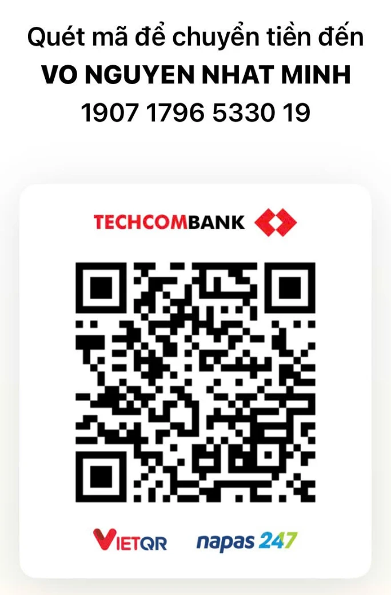

# Tài trợ, ủng hộ Aurora-LAB · Support Aurora-LAB

**Tiếng Việt** · [English](#english)

Aurora-LAB miễn phí và sẽ luôn mở cho mọi người học. Nếu thấy dự án hữu ích, bạn có thể ủng hộ để duy trì và phát triển tiếp.

> **Lưu ý:** khoản ủng hộ được chuyển vào **tài khoản cá nhân của người duy trì dự án**, không phải quỹ của CLB Thiên văn USAC. Ủng hộ là hoàn toàn tự nguyện và không kèm theo quyền lợi hay dịch vụ nào.

Tiền ủng hộ được dùng cho: duy trì tên miền và tiếp tục phát triển dự án.

## Chuyển khoản qua VietQR

Mở app ngân hàng, quét mã và kiểm tra tên người nhận trước khi chuyển.

## Hợp tác, tài trợ cho dự án

Đơn vị, tổ chức muốn tài trợ hoặc hợp tác xin liên hệ:

- Người duy trì dự án: [minhvo.091003.nckh@gmail.com](mailto:minhvo.091003.nckh@gmail.com) · [Facebook](https://www.facebook.com/minhtalichemistryhcmus)
- CLB Thiên văn USAC: [clb.usac@gmail.com](mailto:clb.usac@gmail.com) · [Fanpage](https://www.facebook.com/clbusac)

---

## English

Aurora-LAB is free and will stay open to every learner. If you find it useful, you can support its upkeep and further development.

> **Please note:** donations go to the **project maintainer's personal account**, not to the funds of the USAC Astronomy Club. Donating is entirely voluntary and comes with no benefits or services.

Donations are used for: keeping the domain running and developing the project further.

### From Vietnam

Scan the [VietQR code above](#chuyển-khoản-qua-vietqr) with a Vietnamese banking app.

### From outside Vietnam, partnerships and sponsorship

Please contact us for transfer details or partnership proposals:

- Project maintainer: [minhvo.091003.nckh@gmail.com](mailto:minhvo.091003.nckh@gmail.com) · [Facebook](https://www.facebook.com/minhtalichemistryhcmus)
- USAC Astronomy Club: [clb.usac@gmail.com](mailto:clb.usac@gmail.com) · [Facebook page](https://www.facebook.com/clbusac)
