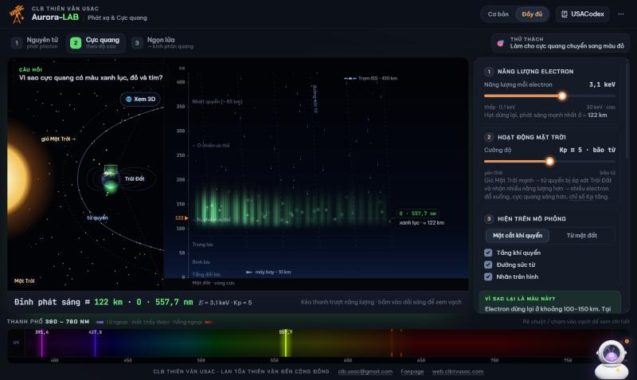
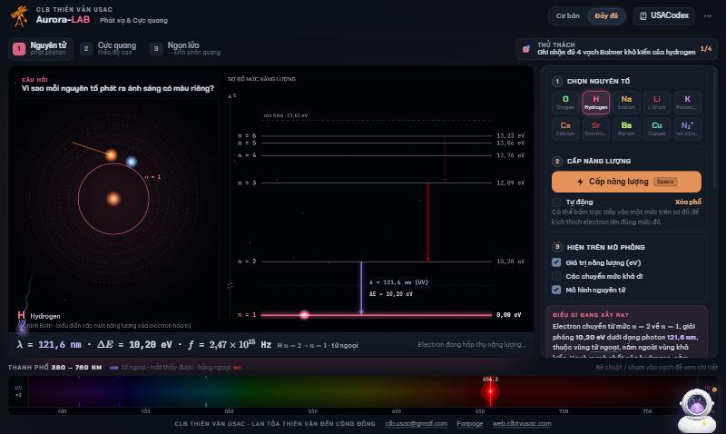
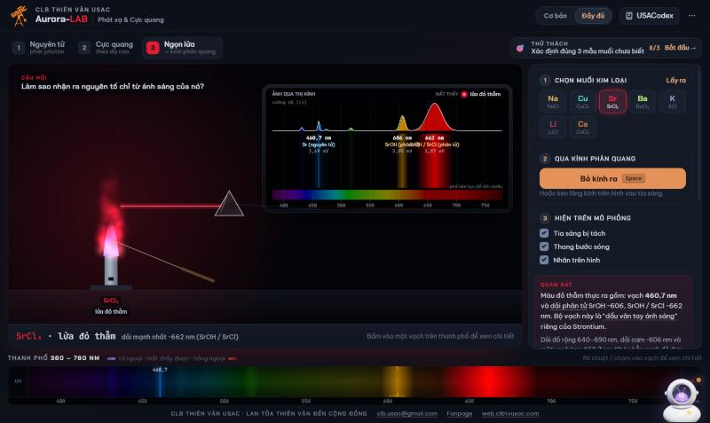
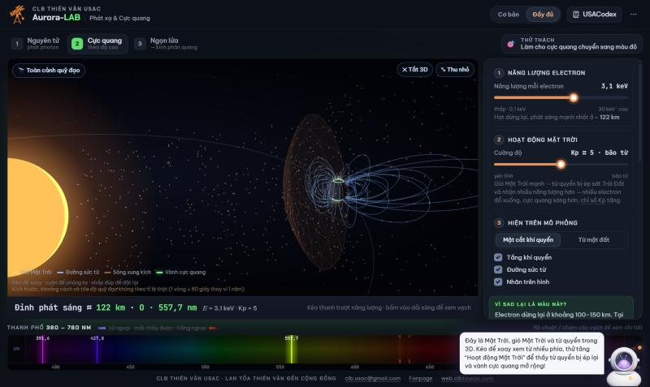
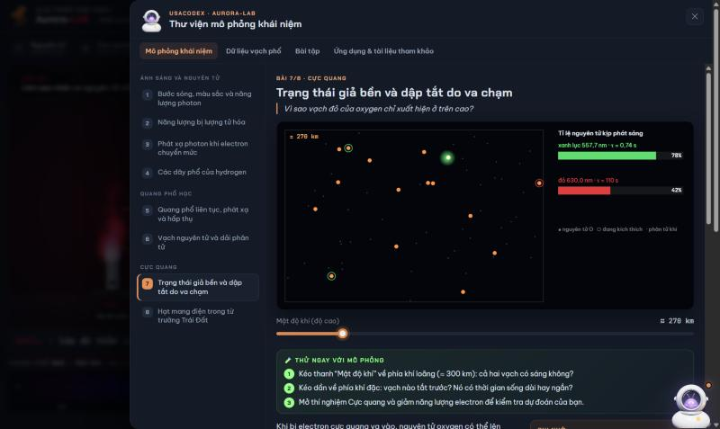
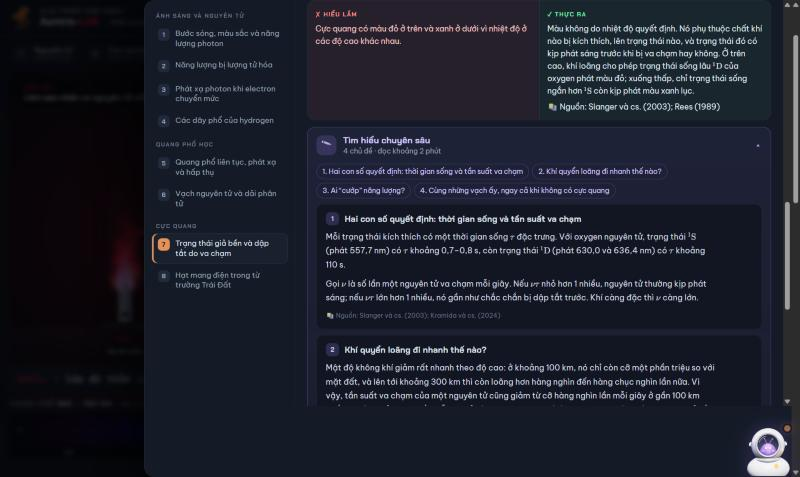
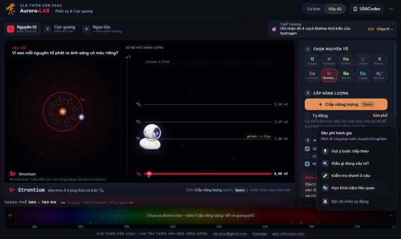

<div align="center">


# Aurora-LAB

[Tiếng Việt](README.md) · **English**

**A virtual laboratory for atomic light and the aurora**

Pump energy into an electron, change the energy of particles raining into the upper atmosphere, put metal salts into a flame, and watch a spectrum build up in front of you.

[](https://auroralab.clbtvusac.com)

[](LICENSE)
[](LICENSE-CONTENT.md)




</div>

> The interface and lessons are in Vietnamese. This page describes the project for international readers.

## About

Almost everything we know about the Universe reaches us as light. A star thousands of light-years away can never be brought into a laboratory, but its light can: spread that light into a spectrum and you can read what the star is made of, how hot it is, and whether it is moving towards or away from us.

**Aurora-LAB** is developed by the **Astronomy Education and Experimental Science Project Team, USAC Astronomy Club** (University of Science, Vietnam National University – Ho Chi Minh City) to let learners discover for themselves how light is "read". It is a static web page: nothing to install, no account, just open it in a browser.

Its three experiments share one core idea: **every element has its own "fingerprint of light".**

1. **Atoms emit photons.** An electron can only occupy certain energy levels. When it drops from a higher level to a lower one, it emits a single photon carrying exactly the energy difference $\Delta E$, with wavelength $\lambda = hc/\Delta E$. Why does each element shine with its own set of colours?
2. **Aurora by altitude.** Electrons accelerated in the magnetosphere plunge into the upper atmosphere and excite oxygen and nitrogen. Why is the aurora green at about 100–150 km, red above 200 km, and pink-violet along its lower edge?
3. **From flame to spectroscope.** Lithium and strontium both turn a flame red, yet their spectra are completely different. How can an element be identified from its light alone?

## Features

| | |
|---|---|
| ⚛️ **Atoms emit photons** | 10 species (H, O, Na, Li, K, Ca, Sr, Ba, Cu, N₂⁺): energy-level diagram, Bohr model, every transition leaves a line on the spectrum bar. Ultraviolet and infrared photons are counted separately. |
| 🌌 **Aurora by altitude** | Drag the electron energy (0.1–30 keV) and watch the glowing band rise, sink and change colour. View it as an atmospheric cross-section or from the ground. |
| 🌍 **Sun–Earth in 3D** | Solar wind, bow shock, magnetosphere and auroral ovals in 3D, with the Earth orbiting the Sun; drag to rotate, scroll to zoom. |
| 🔥 **Flame and spectroscope** | 7 metal salts. The eyepiece view is layered: the colour the eye sees, an intensity plot, the actual lines labelled with their origin (atom or molecule) and photon energy. |
| 🎯 **Challenges** | Catch all four visible Balmer lines, turn the aurora red, identify three unknown salts from their spectra alone. |
| 📖 **USACodex** | 8 lessons, each with its own simulation, a "Try it" activity, a "Common misconception" card and an expandable "Deep dive" section with citations. Plus a spectral-line table, a photon-energy calculator and worked exercises. |
| 🧑‍🚀 **The Astronaut Slug** | A 3D mascot that travels with the learner: suggests the next step, explains what is on screen, runs to wherever something just happened, and celebrates completed challenges. |
| ∑ **Proper formulas** | All equations and symbols are typeset with LaTeX (KaTeX). |
| 🎚️ **Two modes** | *Basic* keeps things simple for beginners; *Full* adds energy values, transition tables and emission-versus-altitude plots. |
| 📱 **Any device** | Responsive layout for desktop, tablet and phone; keyboard shortcuts `1` `2` `3`, `Space`, `?`. |

## Screenshots

| Atoms emit photons | Flame through the spectroscope |
|---|---|
|  |  |
| **Sun, solar wind and magnetosphere (3D)** | **USACodex** |
|  |  |

<details>
<summary>More screenshots</summary>

| Deep dive | The Astronaut Slug |
|---|---|
|  |  |

</details>

## The science behind it

**Photons and energy levels.** A photon's energy and wavelength are related by

$$E = hf = \frac{hc}{\lambda}, \qquad hc \approx 1239.84\ \mathrm{eV\cdot nm},$$

which gives the handy rule $\lambda\,(\mathrm{nm}) \approx 1240 / \Delta E\,(\mathrm{eV})$. For hydrogen, $E_n = -13.6\ \mathrm{eV}/n^2$; transitions down to $n = 2$ form the visible Balmer series (656.3 · 486.1 · 434.0 · 410.2 nm).

**Why the aurora has several colours.** Its two main colours come from atomic oxygen, and both are *forbidden lines*: the ¹S state (emitting 557.7 nm) lives about 0.7 s, the ¹D state (emitting 630.0 nm) about 110 s. Lower down, the air is dense enough that atoms collide and lose their energy before they can radiate (*collisional quenching*). That is why the red line only shines in the very thin air above 200 km, while green dominates at about 100–150 km. More energetic electrons penetrate deeper, where N₂⁺ ions emit violet-blue light at 391.4 / 427.8 nm.

**Atomic lines and molecular bands.** In a flame, calcium, strontium, barium and copper form small molecules such as CaOH, SrOH, BaCl and CuCl. Molecules also vibrate and rotate, so instead of a single sharp line they emit a whole band. Through a spectroscope, this is how strontium (a broad red band at 640–690 nm plus a blue line at 460.7 nm) is told apart from lithium (essentially a single red line at 670.8 nm).

## Accuracy

- Atomic wavelengths, energy levels and lifetimes come from the **NIST Atomic Spectra Database** (Kramida et al., 2024). Lines below 200 nm are vacuum wavelengths; all others are air wavelengths.
- Physical constants follow **CODATA 2018**. Molecular flame bands are given at their peak positions following Gaydon, *The Spectroscopy of Flames* (1974).
- Auroral physics is checked against peer-reviewed work (Slanger & Copeland 2003; Solomon et al. 1988; Fang et al. 2010) and material from the **NOAA Space Weather Prediction Center**.
- Every USACodex lesson lists its own sources; the full list is under *USACodex → Applications & references*.
- **What is illustrative:** intensity ratios in the animations, speeds of motion, the shape of auroral curtains, and the sizes and distances in the 3D Sun–Earth view (the Earth completes an orbit in about 80 seconds instead of a year). Every such simplification is noted in the interface itself.

## Running it locally

Aurora-LAB is a static site with no build step. You only need a simple web server, because browsers will not load JavaScript modules from `file://`.

```bash
git clone https://github.com/minhtali-usac/minhtali-usac.github.io.git aurora-lab
```

```bash
cd aurora-lab
```

```bash
python -m http.server 8765
```

Then open <http://localhost:8765>. An internet connection is needed to load fonts, three.js and KaTeX from CDNs.

## Project structure

```
index.html            Page shell and dialogs (USACodex, Help, About, Quick quiz)
assets/css/style.css  All styling
assets/js/
  data.js           Single source of data: elements, energy levels, spectral lines, glossary, quizzes, references
  core.js           Vietnamese number formatting, wavelength-to-colour, shared state store, KaTeX, Earth rendering
  spectrum.js       The shared 380–780 nm spectrum bar
  sim-atom.js       "Atoms emit photons" experiment
  sim-aurora.js     "Aurora by altitude" experiment
  sunearth3d.js     3D Sun – solar wind – magnetosphere view (three.js, loaded on demand)
  sim-flame.js      "Flame and spectroscope" experiment
  codex.js          USACodex: 8 concept simulations, citations
  codex-deep.js     "Try it", "Common misconception" and "Deep dive" content
  wave3d.js         3D electromagnetic wave (USACodex lesson 1)
  app.js            Orchestration: tabs, control panel, challenges, quiz, shortcuts
  buddy.js          The Astronaut Slug: menu, contextual reactions, movement
  mascot3d.js       3D model of the Astronaut Slug
  fx.js             Confetti when a challenge is completed
docs/anh/             Screenshots used in the README
```

## Contributing

Suggestions, scientific corrections and ideas for new lessons are all welcome: open an [Issue](https://github.com/minhtali-usac/minhtali-usac.github.io/issues), send a Pull Request, or write to clb.usac@gmail.com. For scientific content, please include a reference so the team can verify it.

## License

| Part | License |
|---|---|
| Source code | [MIT](LICENSE) |
| Content written by the club (USACodex lessons, explanations, quizzes, exercises, documentation, screenshots) | [CC BY-NC-SA 4.0](LICENSE-CONTENT.md) |
| USAC Astronomy Club name and logo, the Astronaut Slug mascot | All rights reserved, see [`LICENSE-CONTENT.md`](LICENSE-CONTENT.md) |
| Third-party data, libraries and images | Original licenses, see [`THIRD-PARTY-NOTICES.md`](THIRD-PARTY-NOTICES.md) |

## Contact

<div align="center">

**USAC ASTRONOMY CLUB** · BRINGING ASTRONOMY TO THE COMMUNITY

[Facebook](https://www.facebook.com/clbusac) · [clb.usac@gmail.com](mailto:clb.usac@gmail.com) · [web.clbtvusac.com](https://web.clbtvusac.com) · [auroralab.clbtvusac.com](https://auroralab.clbtvusac.com)

</div>
