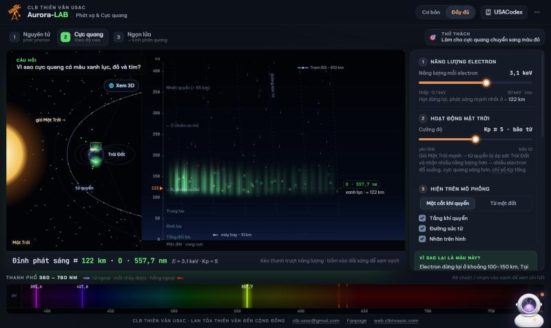
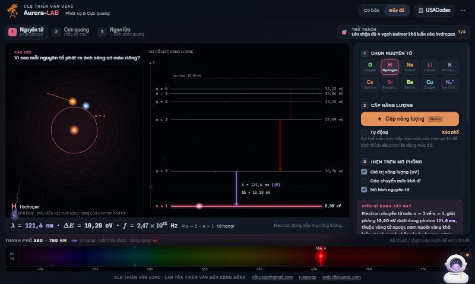
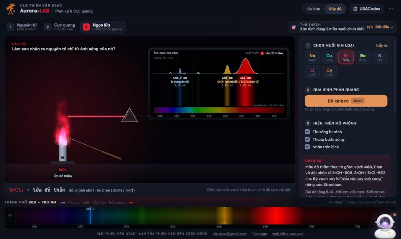
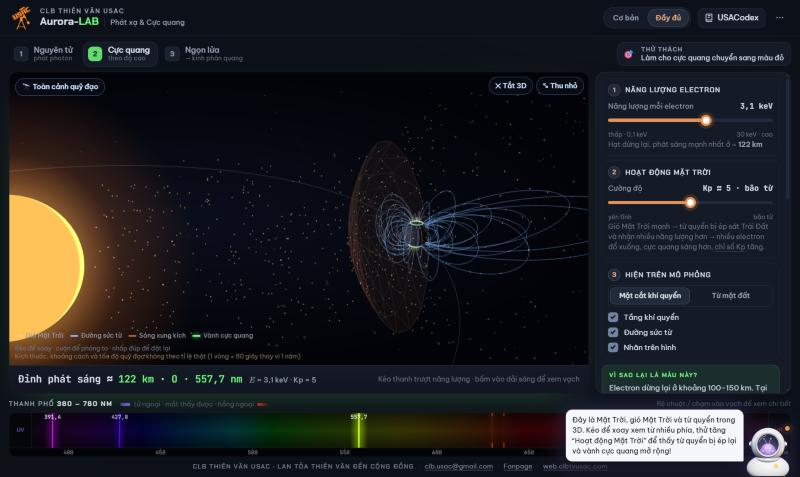
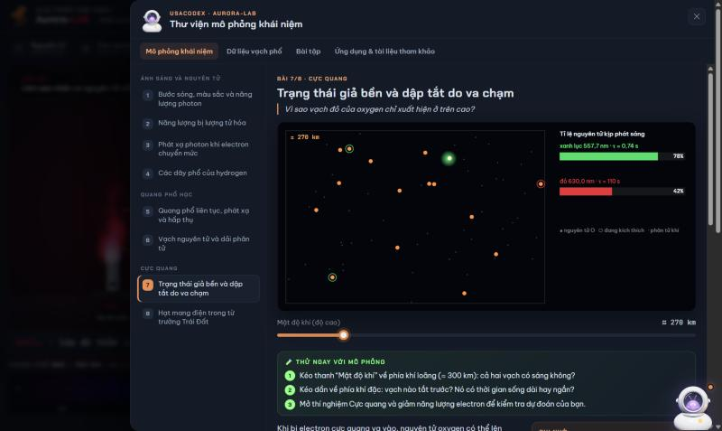
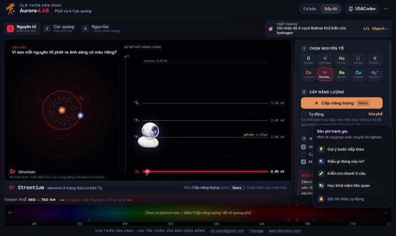

<div align="center">


# Aurora-LAB

**Tiếng Việt** · [English](README.en.md)

**Phòng thí nghiệm ảo về ánh sáng của nguyên tử và cực quang**

Tự tay “cấp năng lượng” cho electron, đổi năng lượng của dòng hạt đổ xuống khí quyển, đưa muối kim loại vào ngọn lửa, và nhìn quang phổ hình thành ngay trước mắt.

[](https://auroralab.clbtvusac.com)

[](LICENSE)




</div>

## Giới thiệu

Hầu hết những gì loài người biết về vũ trụ đều đến từ ánh sáng. Một ngôi sao cách hàng nghìn năm ánh sáng không thể đem vào phòng thí nghiệm, nhưng ánh sáng của nó thì có thể: tách ánh sáng ấy thành quang phổ, ta đọc được ngôi sao làm từ gì, nóng bao nhiêu, đang tiến lại hay lùi xa.

**Aurora-LAB** do **Nhóm Dự án Giáo dục Thiên văn và Khoa học Thực nghiệm, CLB Thiên văn USAC** (Trường ĐH Khoa học Tự nhiên – ĐHQG-HCM) phát triển, để người học tự mình hiểu cách “đọc” ánh sáng. Đây là một trang web tĩnh: không cần cài đặt, không cần đăng nhập, mở trình duyệt là dùng được.

Ba thí nghiệm của Aurora-LAB cùng xoay quanh một ý tưởng nền tảng: **mỗi nguyên tố có một “dấu vân tay ánh sáng” riêng.**

1. **Nguyên tử phát photon.** Electron chỉ được ở những mức năng lượng xác định. Khi rơi từ mức cao xuống mức thấp, nó phát ra một photon mang đúng phần năng lượng chênh lệch $\Delta E$, với bước sóng $\lambda = hc/\Delta E$. Vì sao mỗi nguyên tố lại có bộ màu riêng?
2. **Cực quang theo độ cao.** Electron được gia tốc trong từ quyển lao xuống tầng cao khí quyển và kích thích oxygen, nitrogen. Vì sao cực quang xanh lục ở khoảng 100–150 km, đỏ ở trên 200 km và tím hồng ở rìa dưới?
3. **Ngọn lửa → kính phân quang.** Lithium và strontium đều cho lửa đỏ, nhưng quang phổ thì khác hẳn. Làm thế nào nhận ra nguyên tố chỉ từ ánh sáng của nó?

## Tính năng

| | |
|---|---|
| ⚛️ **Nguyên tử phát photon** | 10 chất (H, O, Na, Li, K, Ca, Sr, Ba, Cu, N₂⁺): sơ đồ mức năng lượng, mô hình Bohr, mỗi chuyển mức tạo một vạch trên thanh phổ. Photon tử ngoại và hồng ngoại được ghi nhận riêng. |
| 🌌 **Cực quang theo độ cao** | Kéo năng lượng electron (0,1–30 keV) để thấy dải sáng lên cao, xuống thấp và đổi màu. Xem theo mặt cắt khí quyển hoặc từ mặt đất. |
| 🌍 **Mặt Trời – Trái Đất 3D** | Gió Mặt Trời, sóng xung kích, từ quyển và vành cực quang trong không gian 3D; Trái Đất quay quanh Mặt Trời; kéo để xoay, cuộn để phóng to. |
| 🔥 **Ngọn lửa và kính phân quang** | 7 muối kim loại. Ảnh qua thị kính có nhiều lớp: màu mắt thấy, đồ thị cường độ, vạch thật kèm nguồn gốc (nguyên tử hay phân tử) và năng lượng photon. |
| 🎯 **Thử thách** | Bắt đủ 4 vạch Balmer, đổi màu cực quang, xác định 3 mẫu muối chưa biết chỉ bằng quang phổ. |
| 📖 **USACodex** | 8 bài học có mô phỏng riêng; mỗi bài có “Thử ngay”, “Hiểu lầm thường gặp” và mục mở rộng “Tìm hiểu chuyên sâu” có dẫn nguồn. Kèm bảng dữ liệu vạch phổ, máy tính năng lượng photon và bài tập có đáp án. |
| 🧑‍🚀 **Sên phi hành gia** | Linh vật 3D đi cùng người học: gợi ý bước tiếp theo, giải thích điều đang thấy, chạy tới chỗ vừa có sự kiện, mừng khi bạn hoàn thành thử thách. |
| ∑ **Công thức chuẩn** | Mọi công thức và ký hiệu hiển thị bằng LaTeX (KaTeX). |
| 🎚️ **Hai chế độ** | *Cơ bản* gọn cho người mới; *Đầy đủ* thêm số liệu năng lượng, bảng chuyển mức, biểu đồ cường độ theo độ cao. |
| 📱 **Mọi thiết bị** | Giao diện co giãn cho máy tính, máy tính bảng và điện thoại; phím tắt `1` `2` `3`, `Space`, `?`. |

## Hình ảnh

| Nguyên tử phát photon | Ngọn lửa qua kính phân quang |
|---|---|
|  |  |
| **Mặt Trời, gió Mặt Trời và từ quyển (3D)** | **USACodex** |
|  |  |

<details>
<summary>Xem thêm ảnh</summary>

| Tìm hiểu chuyên sâu | Sên phi hành gia |
|---|---|
|  |  |

</details>

## Khoa học phía sau

**Photon và mức năng lượng.** Năng lượng của photon và bước sóng liên hệ qua

$$E = hf = \frac{hc}{\lambda}, \qquad hc \approx 1239{,}84\ \mathrm{eV\cdot nm},$$

nên một cách tính nhanh là $\lambda\,(\mathrm{nm}) \approx 1240 / \Delta E\,(\mathrm{eV})$. Với hydrogen, $E_n = -13{,}6\ \mathrm{eV}/n^2$; các chuyển mức về $n = 2$ tạo dãy Balmer nhìn thấy được (656,3 · 486,1 · 434,0 · 410,2 nm).

**Vì sao cực quang có nhiều màu.** Hai màu chính đến từ oxygen nguyên tử, và đều là *vạch cấm*: trạng thái ¹S (phát 557,7 nm) phải “chờ” khoảng 0,7 s, còn trạng thái ¹D (phát 630,0 nm) chờ khoảng 110 s. Ở thấp, không khí dày nên nguyên tử bị va chạm và mất năng lượng trước khi kịp phát sáng (*dập tắt do va chạm*). Vì vậy vạch đỏ chỉ sáng ở tầng rất loãng trên 200 km, còn vạch xanh lục chiếm ưu thế ở khoảng 100–150 km. Electron năng lượng càng cao càng đi sâu xuống, nơi ion N₂⁺ phát màu tím lam 391,4 / 427,8 nm.

**Vạch nguyên tử và dải phân tử.** Trong ngọn lửa, calcium, strontium, barium và copper tạo ra các phân tử nhỏ như CaOH, SrOH, BaCl, CuCl. Phân tử còn dao động và quay, nên thay vì một vạch mảnh, nó phát ra cả một dải. Nhìn qua kính phân quang, đó là cách phân biệt strontium (dải đỏ rộng 640–690 nm kèm vạch lam 460,7 nm) với lithium (gần như chỉ một vạch đỏ 670,8 nm).

## Độ chính xác

- Bước sóng, mức năng lượng và thời gian sống của nguyên tử lấy từ **NIST Atomic Spectra Database** (Kramida và cs., 2024). Vạch dưới 200 nm là bước sóng trong chân không, còn lại là bước sóng trong không khí.
- Hằng số vật lý theo **CODATA 2018**. Dải phân tử trong ngọn lửa ghi vị trí đỉnh dải theo Gaydon, *The Spectroscopy of Flames* (1974).
- Kiến thức về cực quang đối chiếu với các bài báo có bình duyệt (Slanger & Copeland 2003; Solomon và cs. 1988; Fang và cs. 2010) và tài liệu của **NOAA Space Weather Prediction Center**.
- Mỗi bài trong USACodex ghi nguồn riêng; danh sách đầy đủ ở mục *USACodex → Ứng dụng & tài liệu tham khảo*.
- **Những gì là minh họa:** tỉ lệ cường độ trong hoạt cảnh, tốc độ chuyển động, hình dạng dải cực quang, kích thước và khoảng cách trong khung 3D Mặt Trời – Trái Đất (Trái Đất quay một vòng quanh Mặt Trời trong khoảng 80 giây thay vì một năm). Các chỗ đơn giản hóa đều được ghi chú ngay trên giao diện.

## Chạy trên máy của bạn

Aurora-LAB là trang tĩnh, không cần đóng gói. Chỉ cần một máy chủ web đơn giản (vì trình duyệt không cho tải module JavaScript từ `file://`).

```bash
git clone https://github.com/minhtali-usac/minhtali-usac.github.io.git aurora-lab
```

```bash
cd aurora-lab
```

```bash
python -m http.server 8765
```

Mở <http://localhost:8765>. Cần kết nối mạng để tải phông chữ, three.js và KaTeX từ CDN.

## Cấu trúc mã nguồn

```
index.html            Khung trang, các hộp thoại (USACodex, Trợ giúp, Giới thiệu, Kiểm tra nhanh)
assets/css/style.css  Toàn bộ giao diện
assets/js/
  data.js           Cơ sở dữ liệu duy nhất: nguyên tố, mức năng lượng, vạch phổ, thuật ngữ, câu hỏi, tài liệu tham khảo
  core.js           Định dạng số kiểu Việt Nam, màu theo bước sóng, store trạng thái chung, KaTeX, vẽ Trái Đất
  spectrum.js       Thanh phổ 380–780 nm dùng chung cho ba thí nghiệm
  sim-atom.js       Thí nghiệm Nguyên tử phát photon
  sim-aurora.js     Thí nghiệm Cực quang theo độ cao
  sunearth3d.js     Khung 3D Mặt Trời – gió Mặt Trời – từ quyển (three.js, tải khi cần)
  sim-flame.js      Thí nghiệm Ngọn lửa và kính phân quang
  codex.js          USACodex: 8 bài mô phỏng khái niệm, trích dẫn tài liệu
  codex-deep.js     Nội dung “Thử ngay”, “Hiểu lầm thường gặp”, “Tìm hiểu chuyên sâu”
  wave3d.js         Sóng điện từ 3D (bài 1 của USACodex)
  app.js            Điều phối: tab, bảng điều khiển, thử thách, kiểm tra nhanh, phím tắt
  buddy.js          Sên phi hành gia: menu, phản ứng theo ngữ cảnh, di chuyển
  mascot3d.js       Mô hình 3D của Sên phi hành gia
  fx.js             Hiệu ứng pháo giấy khi hoàn thành thử thách
docs/anh/             Ảnh chụp màn hình dùng trong README
```

## Góp ý

Mọi góp ý, báo lỗi khoa học hay đề xuất bài học mới đều được hoan nghênh: mở [Issue](https://github.com/minhtali-usac/minhtali-usac.github.io/issues) hoặc gửi email tới minhvo.091003.nckh@gmail.com hoặc clb.usac@gmail.com. Với nội dung khoa học, xin kèm nguồn tham khảo để nhóm có thể kiểm chứng.

## Bản quyền

© 2026 CLB Thiên văn USAC. **Giữ toàn bộ bản quyền** đối với mã nguồn, nội dung, thiết kế, hình ảnh, tên và logo CLB, linh vật Sên phi hành gia.

Mã nguồn được công khai để tham khảo và minh bạch, không phải giấy phép mở. Bạn được tự do **dùng Aurora-LAB để học tập và giảng dạy**, chia sẻ đường dẫn, trích dẫn ngắn hoặc chụp màn hình kèm ghi công «Aurora-LAB – CLB Thiên văn USAC». Mọi việc sao chép, chỉnh sửa, phân phối lại mã nguồn hay nội dung đều cần sự đồng ý bằng văn bản của CLB (liên hệ: minhvo.091003.nckh@gmail.com hoặc clb.usac@gmail.com). Chi tiết: [`LICENSE`](LICENSE).

Thư viện, phông chữ, dữ liệu và ảnh của bên thứ ba giữ giấy phép gốc, xem [`THIRD-PARTY-NOTICES.md`](THIRD-PARTY-NOTICES.md).

## Liên hệ

<div align="center">

**CLB THIÊN VĂN USAC** · LAN TỎA THIÊN VĂN ĐẾN CỘNG ĐỒNG

[Fanpage](https://www.facebook.com/clbusac) · [minhvo.091003.nckh@gmail.com](mailto:minhvo.091003.nckh@gmail.com) · [clb.usac@gmail.com](mailto:clb.usac@gmail.com) · [web.clbtvusac.com](https://web.clbtvusac.com) · [auroralab.clbtvusac.com](https://auroralab.clbtvusac.com)

</div>
